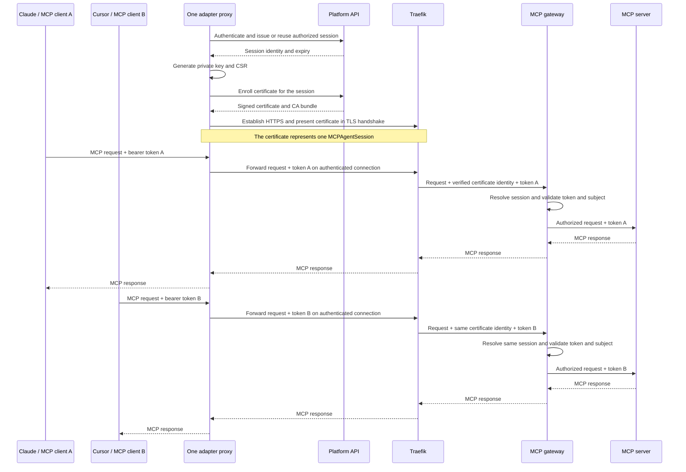

# Agent HTTP Adapter

Use `mcp-runtime adapter proxy` to connect Claude Desktop, Cursor, or another
MCP client to a server on your platform. It runs beside the client: the client
connects to a local URL, and the adapter forwards requests to the platform over
HTTPS.

The adapter gets a certificate for the agent's session and keeps it refreshed.
On an installation configured to verify these certificates, the gateway uses
it to identify the human, agent, team, and session making a tool call. If the
server also requires OAuth, the client must send its bearer token; the adapter
forwards it on each request. The token's user must match the session's user,
and any team claim must match the session. The gateway does not trust identity
headers supplied by the client.

Use an active managed agent from the team's agent directory. List agents with
`mcp-runtime agent list <team-slug> --status active`; a team owner or platform
admin can create one with `mcp-runtime agent create <team-slug> --name <name>`.
Members see only agents covered by an applicable grant or their own active
session, so ask a team owner for an ID if the list is empty. Use the immutable
`agt_...` ID returned by the directory in the grant and adapter commands below.
A display name such as `Cursor` is not an agent ID.

## Inspect authorization in the dashboard

Open **Agents**, select an agent, and inspect its visible session history.
Each session shows the authorizing human and the exact namespace/name of its
recorded grant. Follow either the session or grant link to the shared access
detail view. A missing link is labelled unknown; the UI does not guess a grant
from overlapping rules. Records outside your permitted scope remain unavailable.

The lifecycle summary counts visible active, expired and revoked sessions. Before
deactivation, the confirmation lists visible sessions that will lose access.
Afterward, it re-reads agent and session state, shows recorded revocation causes,
and keeps partial failures visible. Counts cover your view; deactivation also
revokes sessions outside it. Reactivation preserves the ID and history and does
not restore revoked sessions.

Administrators can open **Administration → Usage analytics → Gateway audit**
and load the latest 100 events. Matched grant/session links include their recorded
namespaces. The shared detail view queries the most recent 1,000 matching events
from the last seven days and shows loaded allow/deny/would-deny counts. This is a
bounded view of delivered events, not a complete usage total. Gateway events
remain restricted to administrators; an unavailable analytics service is shown
as an error rather than an empty history.

## Required grant

Create an enabled `MCPAccessGrant` before starting the adapter. The grant must
match the target server and agent. The platform refuses session and certificate
issuance when no grant matches.

```yaml
apiVersion: mcpruntime.org/v1alpha1
kind: MCPAccessGrant
metadata:
  name: triage-grant
  namespace: mcp-team-acme
spec:
  serverRef:
    name: workspace-assistant
  subject:
    agentID: agt_01arz3ndektsv4rrffq69g5fav # replace with your active agent ID
  maxTrust: high
  allowedSideEffects: [read]
  policyVersion: v1
  toolRules:
    - name: add
      decision: allow
```

## In-memory enrollment

Log in, then start the proxy with the server and agent identifiers:

```bash
mcp-runtime auth login --api-url https://platform.example.com

mcp-runtime adapter proxy \
  --runtime-url https://mcp.example.com/workspace-assistant/mcp \
  --server workspace-assistant \
  --namespace mcp-team-acme \
  --agent agt_01arz3ndektsv4rrffq69g5fav \
  --auto-refresh
```

For an OAuth-enabled target, the local MCP client normally completes OAuth and
sends `Authorization` to the adapter. The proxy preserves it for each request.
For a client that cannot attach the header, set `--auth-header "Bearer
<access-token>"`; this static value is used for every request. Omit it when the
target has no OAuth configuration or when clients need to send different
tokens.

The adapter:

1. Requests an `MCPAgentSession` that is authorized by the matching grant.
2. Generates the private key and CSR locally.
3. Sends the CSR to the platform certificate endpoint.
4. Receives the signed leaf certificate and CA bundle.
5. Presents the certificate during the HTTPS handshake and forwards each
   request's OAuth bearer when the target requires one.
6. Renews the certificate before it expires when `--auto-refresh` is enabled.

The private key never leaves the adapter process.

### Certificate identity and OAuth tokens

The adapter certificate identifies one `MCPAgentSession`; it does not identify
an individual MCP protocol session or contain an OAuth token. The certificate
is presented during the HTTPS handshake. The local MCP client sends its OAuth
bearer on each HTTP request, and the proxy forwards that request's
`Authorization` header over the authenticated connection. The gateway checks
the certificate identity and, when OAuth is enabled, requires the token subject
to match the session's human and any team claim to match the session's team.



This works when both OAuth tokens are valid for the target MCP resource and
identify the same human as the certificate-bound session. A token for another
human is rejected. Both clients' calls are attributed to the same Runtime
agent and session. If clients need distinct Runtime agent identities or
session-level audit attribution, run a separate adapter proxy with its own
certificate for each identity. On macOS, `mcp-runtime adapter service` keeps
those connections in one user daemon. Each server has its own path, such as
`http://127.0.0.1:8099/cully/mcp`, and its own certificate. The listener is
only that loopback port. Platform OAuth is unchanged.

The macOS service listener is `127.0.0.1:8099` and requires the per-profile
`X-MCP-Runtime-Local-Token` header. Export it through the supported client
configuration command; the daemon strips this local credential before
forwarding the request upstream. The foreground `adapter proxy` command has
its own listener behavior and should be treated separately.

Do not set `--auth-header` when clients need different OAuth tokens. It is a
static override applied to every outbound request, so it replaces each
client's per-request bearer. Let each client send its own `Authorization`
header instead. `--auto-refresh` refreshes the adapter certificate; each MCP
client remains responsible for obtaining and refreshing its OAuth token.

## Save a certificate

Use `adapter enroll` when another process manages the proxy lifecycle:

```bash
mcp-runtime adapter enroll \
  --server workspace-assistant \
  --namespace mcp-team-acme \
  --agent agt_01arz3ndektsv4rrffq69g5fav
```

The command saves credentials below
`$MCP_RUNTIME_CONFIG_DIR/certs/<scope>`; the default root is
`~/.mcpruntime/certs`. The scope is deterministic for the platform, namespace,
server, agent, and SPIFFE identity. The command prints the exact directory.

- `client.key` is the locally generated private key, mode `0600`.
- `client.crt` is the session-bound leaf certificate, mode `0600`.
- `ca.crt` is the CA bundle used to verify the runtime TLS certificate.

Start the proxy with the saved files:

```bash
mcp-runtime adapter proxy \
  --runtime-url https://mcp.example.com/workspace-assistant/mcp \
  --tls-client-cert ~/.mcpruntime/certs/<scope>/client.crt \
  --tls-client-key ~/.mcpruntime/certs/<scope>/client.key \
  --tls-ca-bundle ~/.mcpruntime/certs/<scope>/ca.crt
```

For an OAuth-enabled target, the local MCP request must still carry
`Authorization`, or the proxy must be started with `--auth-header`. The
certificate files identify the enrolled Runtime session; the OAuth bearer is
still a separate per-request credential.

## CA bundle and CSR flow

The adapter creates a private key and a PKCS#10 CSR containing the expected
session SPIFFE URI. The platform validates the CSR against the issued
`MCPAgentSession`, signs it with the configured workload issuer, and returns:

- the signed client certificate;
- the CA certificate chain required to verify platform TLS certificates;
- the SPIFFE ID and expiry time.

The CA bundle does not receive or sign the CSR itself. The platform certificate
endpoint submits the validated request to the configured issuer and returns the
issuer's chain as the bundle.

## macOS background adapter and companion

The macOS CLI can run isolated adapter profiles in a per-user background
service. Each profile is explicitly authorized for one platform, team, human,
agent, server and session; local MCP clients receive a separate owner-only
credential. Session expiry still requires interactive authorization. The
native companion is a normal Dock app with one status/control window. It uses
the bundled CLI's protected management API, never reads credential storage,
and leaves the daemon running when closed or quit. It reports local readiness
separately from upstream host reachability, profile identity, certificate
expiry and redacted errors. A reachable host does not prove MCP authorization.
Background renewal stays within the existing session. After signing in,
choosing **Reconnect** explicitly authorizes a fresh session when the previous
one has expired or requires authorization.

```bash
mcp-runtime adapter service install
mcp-runtime adapter service profile add \
  --server workspace-assistant \
  --runtime-url https://mcp.example.com/workspace-assistant/mcp \
  --namespace mcp-team-acme \
  --agent agt_01arz3ndektsv4rrffq69g5fav
mcp-runtime adapter service profile client-config PROFILE_ID --output ~/mcp-work.json
mcp-runtime adapter service status
```

`profile add` uses the selected interactive platform login to authorize the
session. It prints the generated profile ID for the `client-config` command.
`client-config` refuses to overwrite an existing file and writes the local
credential with mode `0600`; protect that file as a credential. The daemon
binds only to IPv4 loopback, rejects browser-origin requests, and requires the
profile's local token. `service logs` and `service status` report
fixed redacted events and measured state, not certificates, private keys,
tokens or MCP payloads. `service uninstall` preserves profiles unless
`--purge` is supplied. This daemon slice is for macOS and is not a substitute
for the existing foreground `adapter proxy` workflow on other platforms.

The companion and daemon use the same `MCP_RUNTIME_CONFIG_DIR` override, so
custom profile directories remain manageable in the Dock app and survive
LaunchAgent starts. The companion targets macOS 13 or later on Apple Silicon and Intel. Its
authoritative target and Swift 5 language mode are in `hack/release/macos-adapter/package.sh`;
use Xcode 14 or later from [Apple's Xcode distribution](https://developer.apple.com/xcode/)
and select its command-line tools (`xcode-select --install` for the standalone
tools). These requirements were reviewed on 2026-10-17; this change does not
upgrade a developer's installed toolchain. The package script builds both
architectures without opening the app, starting the daemon or contacting a
platform:

```bash
bash hack/release/macos-adapter/package.sh dist/macos-adapter
```

Without release credentials the script creates explicitly named unsigned
preview archives. For distribution, configure a Developer ID Application
identity and a `notarytool` profile in the build user's Keychain, then set
`CODESIGN_IDENTITY` and `NOTARY_KEYCHAIN_PROFILE` before running the same
command. Signing runs inside-out with the hardened runtime, submits to Apple,
staples the accepted ticket and verifies Gatekeeper before producing
`*-notarized.zip`. See Apple's
[notarization workflow](https://developer.apple.com/documentation/security/notarizing-macos-software-before-distribution)
and [Developer ID guidance](https://developer.apple.com/developer-id/).

Download `MCPRuntimeAdapter-unsigned-preview.zip` from the
[GitHub release assets](https://github.com/tavric-labs/mcp-runtime/releases/latest).
The same release includes the universal CLI and `SHA256SUMS` to verify downloads.
The desktop archive is an unsigned preview; Developer ID signing and notarization
are not configured for release automation yet. macOS may require you to allow
the app in **System Settings → Privacy & Security** after opening it.

Alternatively, install the CLI and desktop app together without sudo:

```sh
curl -fsSL https://raw.githubusercontent.com/mcp-runtime/mcp-runtime/main/install.sh | sh -s -- --with-desktop
```

The installer verifies both downloads against the release's `SHA256SUMS`, places
the CLI in `~/.local/bin` and the app in `~/Applications/MCPRuntimeAdapter.app`.
Set `MCP_RUNTIME_INSTALL_DIR` or `MCP_RUNTIME_APP_DIR` to choose other writable
directories, or `MCP_RUNTIME_VERSION=v0.12.0` to choose a release. It preserves
existing app bundles: quit and move the old app aside before reinstalling.
It does not start the app or background service, sign in, or change profiles.

Unzip the companion archive, drag **MCP Runtime Adapter.app** into
**Applications**, then open it. With no service installed, the empty screen
offers **Install and start**. Sign in with `mcp-runtime auth login`, choose
**Add your first profile**, and enter the server name and active Agent ID from
the platform's **Agents** page. The team comes from the issued platform session.
Set **Namespace** in Advanced connection settings only when the server is outside
your primary namespace. Then choose **Connect your agent** on its card. The
client-specific actions add the endpoint using each app's supported format:

| Agent | Install action | Configuration |
|---|---|---|
| Cursor | **Install in Cursor** | Merges a named entry into `~/.cursor/mcp.json` (`mcpServers`). |
| Codex | **Install in Codex** | Adds a named Streamable HTTP entry and local profile header to `~/.codex/config.toml`. |
| Claude Code | **Install in Claude Code** | Uses `claude mcp add` with user scope and the profile's local header. |
| VS Code | **Install in VS Code** | Merges a named entry into the current user's `mcp.json` (`servers`). |

Open **Advanced connection settings** when the platform MCP endpoint is not
`https://mcp.mcpruntime.org/<server>/mcp`. Enter any HTTP or HTTPS MCP URL. Turn
on **This is the complete MCP endpoint URL** to use the value exactly, including
custom paths and query parameters; leave it off to append `/<server>/mcp` to a
base URL. The platform API address is taken from the current CLI sign-in.

These install actions preserve existing entries and stop if the generated name
is already present. The generated per-profile local credential is stored with
the client configuration. Files written directly by the app use owner-only
permissions; Claude Code's CLI manages its own config file.
Profiles whose platform server configuration enables OAuth show an **OAuth
required** tag. Complete that authorization in your MCP client; **Enrolled**
describes the adapter certificate and does not mean OAuth sign-in is complete.
The requirement is read when enrolling or renewing a profile. Reconnect to
refresh it after a server configuration change. If metadata cannot be read,
Inspect shows the OAuth requirement as unknown.
Use **Export config file…** to choose a different destination, or copy the local
MCP URL to configure another agent manually. Use the **Service** menu for
start, restart, stop, and uninstall; destructive actions explain what they keep
before continuing. Removing a profile deletes its local token and certificate,
but does not revoke its platform session.

For manual configuration, see the official [Cursor MCP guide](https://docs.cursor.com/context/model-context-protocol), [Codex MCP setup](https://developers.openai.com/learn/docs-mcp), [Claude Code MCP guide](https://docs.anthropic.com/en/docs/claude-code/mcp), and [VS Code MCP reference](https://code.visualstudio.com/docs/agents/reference/mcp-configuration).

To update, replace the app and choose **Update service from this app** from its
**Service** menu; the
CLI copies a stable managed binary and preserves profiles. The app and daemon
require management protocol version 1. To remove startup
and stop the daemon, run `mcp-runtime adapter service uninstall`; deleting the app alone does
not uninstall the daemon. Remove stored profiles only through the explicit CLI
purge option. Signing/notarization and real macOS sleep/wake, install/update/
uninstall and two-profile desktop acceptance still need release evidence;
Linux/headless compilation checks cannot establish those results.

## Optional header mode

Use header mode when the MCP server authenticates the caller with its own
credential headers and a Runtime certificate is not required. The adapter is
optional: a direct client can send those headers itself. Header mode does not
enroll a certificate, create a platform session, or invent a Runtime identity.

```bash
mcp-runtime adapter proxy \
  --auth-mode header \
  --runtime-url https://mcp.example.com/pilot/mcp \
  --credential-header-env X-Example-Credential=EXAMPLE_TOKEN \
  --credential-header-env Authorization=EXAMPLE_AUTHORIZATION
```

The same settings can live in a YAML file passed with `--config`. The file
stores source references, never secret values. Environment sources are read
from this process and change only when the adapter restarts. File sources are
reread on each request, so a mounted secret can rotate without a restart.
Relative file paths resolve from the config file's directory.

```yaml
authMode: header
runtimeURL: https://mcp.example.com/pilot/mcp
credentialHeaders:
  X-Example-Credential:
    env: EXAMPLE_TOKEN
  Private-Token:
    file: ./private-token
```

Every configured header is injected unchanged. There is no built-in list of
header names or credential schemes. The value is pinned to that HTTPS URL.
The adapter does not follow a redirect to another target. A client-supplied
value that differs from the configured source is rejected. `--auth-header`
cannot also supply `Authorization`. Verified HTTPS is required for credential
injection, including when certificate mode injects a credential. Header mode
does not accept a client certificate or `--tls-insecure-skip-verify`.

## Configuration

| Environment variable | Purpose |
|---|---|
| `MCP_RUNTIME_AUTH_MODE` | `certificate` (default) or `header`. Header mode skips certificate enrollment. |
| `MCP_RUNTIME_URL` | Absolute HTTPS Streamable HTTP MCP route. |
| `MCP_RUNTIME_ADAPTER_SERVER` / `MCP_RUNTIME_ADAPTER_AGENT` | Server and agent for in-memory certificate enrollment. |
| `MCP_RUNTIME_ADAPTER_NAMESPACE` | Target namespace. |
| `MCP_RUNTIME_ADAPTER_AUTO_REFRESH` | Renew an in-memory certificate before expiry. |
| `MCP_PLATFORM_API_URL` | Platform API base URL. |
| `MCP_TRUST_DOMAIN` | Optional SPIFFE trust domain check. |
| `MCP_RUNTIME_TLS_CLIENT_CERT` / `_KEY` | Externally managed PEM client certificate and key. |
| `MCP_RUNTIME_TLS_CA_BUNDLE` | PEM CA bundle used to verify the runtime. |
| `MCP_RUNTIME_AUTH_HEADER` | Static OAuth `Authorization` override when the local MCP client does not send one; it does not set adapter identity and is used for every request. |
| `MCP_RUNTIME_HOST_HEADER` | Override the HTTP Host header for ingress routing. |
| `MCP_RUNTIME_LISTEN_ADDR` | Local proxy listener; defaults to `127.0.0.1:8099`. |
| `MCP_RUNTIME_REQUEST_TIMEOUT` | Timeout for adapter to runtime requests. |
| `MCP_RUNTIME_MAX_INBOUND_BYTES` | JSON-RPC request body limit; defaults to 16 MiB. |
| `MCP_RUNTIME_LOG_LEVEL` | `info` logs runtime denials to stderr. |

Non-HTTPS runtime URLs, missing certificates, invalid key pairs, and
certificate enrollment failures stop the adapter before it begins listening.
When the target enables OAuth, the gateway also rejects requests that lack a
bearer token or whose OAuth subject does not match the certificate's enrolled
session. When OAuth is omitted, the verified certificate alone authenticates
the adapter.

## Enterprise mTLS and SPIFFE

To authenticate adapters with session-bound client certificates, install
cert-manager and an internal `ClusterIssuer` backed by your company CA, Vault,
ADCS, or another workload PKI. Do not use Let's Encrypt for client certificates.
Production requires a Ready issuer with an independent workload signing root;
setup rejects the shared bundled registry CA and aliased/copied signing keys.
The PKI owner manages encrypted off-host recovery, overlapping trust and leaf
renewal: see [CA lifecycle](cli-reference.md#bundled-workload-ca-lifecycle).

Local `setup --test-mode` installs cert-manager and provisions the bundled
`mcp-runtime-ca` ClusterIssuer automatically so this flow can be validated on
Kind without public DNS or a production CA.

```bash
mcp-runtime setup \
  --with-tls \
  --tls-cluster-issuer letsencrypt-prod \
  --mtls-cluster-issuer company-workload-ca
```

Adapter certificate authentication on **gateway** server routes is opt-in: set
`MCP_ADAPTER_CERTIFICATES=true` for setup (it passes it to the operator) in
addition to naming a workload issuer with `--mtls-cluster-issuer`. Enabling it
moves every gateway-enabled server that uses the Traefik ingress class from a
plain Ingress to a Traefik IngressRoute, and puts the gateway behind an mTLS hop
that only Traefik can reach; servers are then no longer reachable directly on
their Service. It requires `--with-tls` because Traefik terminates client TLS;
the IngressRoute uses the operator's configured ingress entrypoints (`websecure`
when none are set). `--tls-cluster-issuer` controls public ingress and registry
certificates and is separate from the workload issuer. Set `MCP_TRUST_DOMAIN` to
the platform's SPIFFE trust domain. Production must configure both
`MCP_TRUST_DOMAIN` and `MCP_SETUP_MTLS_CLUSTER_ISSUER`; test mode defaults the
issuer to `mcp-runtime-ca`.

Enrollment checks this deployed operator choice before creating a session. The
operator and runtime API must use the same workload issuer and trust domain,
and the selected IngressRoute must request and verify client certificates using
the configured workload CA bundle. Preflight reads deployment/ConfigMap, issuer,
route and TLSOption metadata; it never reads certificate private keys. Secret-backed
operator configuration is reported as unavailable. Normal `mcp-runtime update`
installs these read-only permissions and preserves the existing on/off choice.
If certificate issuance later fails, the CLI conditionally deletes only its new
pending enrollment, with a bounded cleanup attempt even after cancellation.
Completion and cleanup check current session state under the same store lock as
revocation, so cleanup cannot remove a completed session or reactivate a revoke.

**Approval gate.** The runtime API creates the session certificate as a
cert-manager `CertificateRequest` against the workload issuer, and cert-manager
auto-approves requests to built-in issuers by default. Any other principal able
to create a `CertificateRequest` for that issuer could therefore obtain a
certificate with a forged SPIFFE URI outside the runtime API's session checks.
Outside `--test-mode`, setup refuses `MCP_ADAPTER_CERTIFICATES=true` unless
`MCP_WORKLOAD_ISSUER_APPROVAL_ACK=true` asserts that an effective approver gates
the issuer (Staging E2E sets this for its disposable VM). Installing the
approver-policy CRD alone does not establish a policy or disable cert-manager's
default auto-approver; either condition can leave forged requests approvable.
Before acknowledging the gate, verify that the policy allows only the runtime
API service account, `digital signature` +
`client auth` usages, and the `spiffe://<trust-domain>/ns/<ns>/session/<name>`
URI shape, and the default approver should be disabled for this issuer only after
that policy is tested (keep public and internal TLS issuance working, and roll
back by re-enabling the default approver). The runtime API also rejects any
issued certificate whose URI, key, usages, or lifetime differ from the submitted
CSR, and its ClusterRole only grants `create` and `get` on `CertificateRequests`.

**Approval policies for production.** `config/cert-manager/approval-policies.yaml`
holds the hosted policy set. Turning off cert-manager's default approver is
cluster-wide, so every request the platform makes needs a policy:

| Policy | Requester | Issuer | Allows |
|---|---|---|---|
| `mcp-session-certificates` | `mcp-platform/mcp-runtime-api` | `mcp-runtime-ca` | one `spiffe://<trust-domain>/ns/*/session/*` URI, usages `digital signature` + `client auth`, no DNS names, not a CA |
| `mcp-workload-tls` | `cert-manager/cert-manager` | `mcp-runtime-ca` | gateway/registry server certificates and the Traefik proxy URI only; never a session URI |
| `mcp-public-acme` | `cert-manager/cert-manager` | `letsencrypt-prod` | `mcpruntime.org` and `*.mcpruntime.org` server certificates |

Adjust the trust domain and the Traefik identity in the file to match
`MCP_TRUST_DOMAIN` and `MCP_INGRESS_CONTROLLER_*`, and the public domain to your
own. A request that no policy applies to is never approved and never issued; it
stays pending.

Rehearse first on a throwaway Kind cluster (it creates and removes its own
cluster and kubeconfig, and asserts approval, denial and renewal):

```bash
hack/qa/approval-policy-rehearsal.sh
```

The rehearsal pins cert-manager **v1.21.2**, approver-policy **v0.28.0** and a
digest-pinned Kubernetes **1.36.4** Kind node (reviewed 2026-10-17). It refuses an
existing cluster name and keeps Helm state inside its temporary directory.
The node pin comes from [Kind v0.33.0](https://github.com/kubernetes-sigs/kind/releases/tag/v0.33.0);
cert-manager's [support matrix](https://cert-manager.io/docs/releases/) covers
Kubernetes 1.33–1.36 for the 1.21 series. The Workload Issuer Approval PR workflow
runs this headless admission matrix on its own GitHub runner.
These are admission tests using direct CertificateRequests, including hidden
`otherName`/`directoryName` SANs; they do not replace the supported CLI adapter
enrollment journey. The runtime API and adapter also inspect the complete SAN
extension, because Go's parsed URI/DNS fields omit those additional name types.
Approver-policy versions before v0.27.0 lack fixes for raw SAN and subject
validation bypasses; use the reviewed pin rather than the former v0.17.0 example.
See the [upstream security fixes](https://github.com/cert-manager/approver-policy/releases/tag/v0.27.0)
and [v0.28.0 maintenance release](https://github.com/cert-manager/approver-policy/releases/tag/v0.28.0).

Then, in this order, with the production kubeconfig passed explicitly:

1. On cert-manager v1.21.2, install the reviewed approver:
   `helm upgrade --install approver-policy oci://quay.io/jetstack/charts/cert-manager-approver-policy
   --version v0.28.0 -n cert-manager --wait`. Confirm its Deployment is ready.
   It changes no approval decisions while the default approver is still enabled.
2. `kubectl apply -f config/cert-manager/approval-policies.yaml` and confirm all
   three policies report `Ready=True`.
3. Add `--controllers=*,-certificaterequests-approver` to the `cert-manager`
   Deployment arguments. Keep a copy of the Deployment YAML first.
4. Verify a gateway certificate and a session certificate still issue, and that
   no legitimate `CertificateRequest` is left pending. Negative requests must
   remain denied or unapproved with no issued certificate.
5. Only then set `MCP_WORKLOAD_ISSUER_APPROVAL_ACK=true` for setup and enable
   `MCP_ADAPTER_CERTIFICATES=true` on the operator.

To roll back, remove that argument (or reapply the saved Deployment); the default
approver resumes immediately. Install approver-policy and its policies before
disabling the default approver, never after.

OAuth is independent. Omit `spec.auth` for a cert-only governed route; add
`spec.auth` only when direct clients (or adapters calling an OAuth-enabled
target) need a bearer. Do not apply empty `auth: {}` unless you intend to turn
OAuth on via the derived issuer.

```yaml
# Cert-only (adapters present the session certificate; no bearer required)
spec:
  ingressHost: mcp.mcpruntime.org
  publicPathPrefix: workspace-assistant
  ingressClass: traefik
  gateway:
    enabled: true
  # omit auth

# Optional OAuth on the same certificate-capable route
spec:
  ingressHost: mcp.mcpruntime.org
  publicPathPrefix: workspace-assistant
  ingressClass: traefik
  gateway:
    enabled: true
  auth:
    mode: oauth
    issuerURL: https://auth.mcpruntime.org
    audience: https://mcp.mcpruntime.org/workspace-assistant/mcp
```

**How termination works.** Traefik verifies a presented adapter client
certificate against the platform workload CA, asserts the verified SPIFFE
identity to the gateway, and re-encrypts over a second mTLS hop. Client-supplied
`X-MCP-*` identity headers are not trusted. Ordinary OAuth clients without a
client certificate continue with Bearer only on OAuth-enabled servers. The
operator generates the Traefik `TLSOption` (`VerifyClientCertIfGiven`), the
`spiffe-identity` middleware, a `ServersTransport` (re-encrypted hop with a
pinned ingress certificate), and a path-based `IngressRoute`. A
`NetworkPolicy` restricts the gateway port to the ingress so the SPIFFE
assertion cannot be forged by another pod, and the gateway requires a
verified mTLS hop before trusting that assertion.

The caller-facing server certificate for the route is published as Traefik's
**default certificate** via a single `TLSStore` named `default`, not a
per-IngressRoute `secretName` (Traefik resolves `secretName` only in the
IngressRoute's own tenant namespace, where the shared platform host certificate
does not exist). Configure the operator with `MCP_DEFAULT_INGRESS_TLS_SECRET`
(the host certificate Secret) and `MCP_DEFAULT_INGRESS_TLS_SECRET_NAMESPACE` (a
Traefik-watched namespace holding that Secret); the operator then reconciles the
one `default` TLSStore there. When unset, Traefik falls back to its built-in
default certificate.

**Kind contributor cluster.** Adapter-certificate IngressRoutes are
websecure-only. Port-forward both Traefik ports and probe HTTPS with an
insecure TLS skip for the local default cert:

```bash
kubectl port-forward -n traefik svc/traefik 18080:8000 18443:8443
# Platform / plain Ingress samples: http://127.0.0.1:18080/...
# Adapter-certificate MCP routes: https://127.0.0.1:18443/<publicPathPrefix>/mcp
```

Enroll an external adapter after signing in to the platform:

```bash
mcp-runtime adapter enroll \
  --platform-url https://platform.mcpruntime.org \
  --server workspace-assistant \
  --namespace mcp-team-acme \
  --agent agt_01arz3ndektsv4rrffq69g5fav \
  --trust-domain mcpruntime.org
```

The command generates `client.key` locally and submits only a CSR. The platform
checks that the SPIFFE URI identifies a session owned by the signed-in
principal, then returns short-lived `client.crt` and `ca.crt` under
`MCP_RUNTIME_CONFIG_DIR/certs` (normally `~/.mcpruntime/certs`).
`--platform-url` takes scheme and host with no `/api` path, and defaults to the
URL saved by `auth login` or `$MCP_PLATFORM_API_URL`. Because enrollment is
session-bound, the grant prerequisite above applies here too.

```bash
mcp-runtime adapter proxy \
  --runtime-url https://mcp.mcpruntime.org/workspace-assistant/mcp \
  --tls-client-cert ~/.mcpruntime/certs/<scope>/client.crt \
  --tls-client-key ~/.mcpruntime/certs/<scope>/client.key \
  --tls-ca-bundle ~/.mcpruntime/certs/<scope>/ca.crt
```

### One-command mode

Pass `--server` and `--agent` to `adapter proxy` so it enrolls a session-bound
certificate in memory at startup (nothing is written to disk) and feeds it
straight to the runtime transport:

```bash
mcp-runtime adapter proxy \
  --runtime-url https://mcp.mcpruntime.org/workspace-assistant/mcp \
  --platform-url https://platform.mcpruntime.org \
  --server workspace-assistant \
  --namespace mcp-team-acme \
  --agent agt_01arz3ndektsv4rrffq69g5fav \
  --trust-domain mcpruntime.org \
  --auto-refresh
```

In-memory enrollment requires an `https` `--runtime-url` and the same
`--server`/`--agent` inputs as `enroll` (the certificate's SPIFFE URI encodes
the issued session). With `--auto-refresh`, the adapter enrolls a replacement
certificate before the current certificate expires and drains idle
connections so subsequent requests renegotiate with it. Long-running adapters
keep working without restarts. To reuse `enroll` output instead of in-memory
enrollment, pass the `--tls-client-cert`/`-key`/`-ca-bundle` files.

Adapters authenticate with the session-bound certificate; grant and session
policy authorize that identity. On OAuth-enabled targets they also forward the
bearer and the gateway binds the certificate session human to the OAuth
subject. Existing MCPServer resources using the removed `auth.mode: mtls` must
omit `spec.auth` for cert-only routes or set `auth.mode: oauth` with
`issuerURL` and `audience` when OAuth is required. Set platform-wide
`MCP_TRUST_DOMAIN` and `MCP_MTLS_CLUSTER_ISSUER` to enable adapter enrollment;
test-mode defaults the issuer to `mcp-runtime-ca`.

The gateway derives adapter governance identity from the verified SPIFFE URI
and the operator-rendered session binding.

## Next steps

Verify an allowed and a denied tool call, then inspect the gateway decisions in
[Services and Observability](platform-services.md). For identity or policy
failures, use [Troubleshooting](troubleshooting.md) and
[Identity and Authorization](identity-and-authorization.md).

For a server requiring OAuth, follow [MCP OAuth](mcp-oauth.md) for token and
resource configuration. Return to [Server and Client Guides](usage-overview.md)
for the complete publishing and access flow.

### Server authentication badges

The catalog shows **OAuth** when the server reports OAuth support, and
**Header** when it uses caller-supplied credential headers. Servers without
reported authentication support have no authentication badge. OAuth support
does not itself mean every connection requires an OAuth token; use the
server's connection instructions and adapter requirements.
